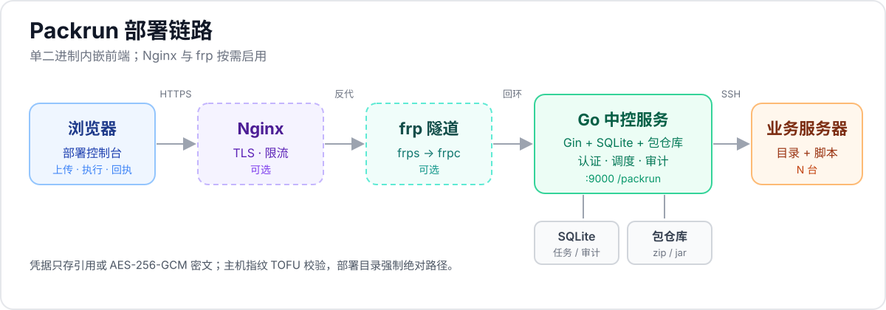

# Packrun

自建 Go 上传部署服务 + frp 外网访问。中控机纳管多台业务服务器，浏览器端完成
「选服务器 → 选目录 → 上传 zip/jar → 绑定脚本 → 执行 → 看回执」的完整链路。

<p align="center">
  
</p>

> 图片为链路示意；Nginx 与 frp 按需启用，直连内网时可以直接访问中控机 `:9000/packrun/`。

## 目录

```
server/            Go 中控服务
  cmd/packrund/    入口
  configs/         配置样例
  internal/
    config/        配置加载（YAML + 环境变量覆盖）
    model/         实体定义
    store/         持久化与初始化
    auth/          口令、JWT、TOTP
    deploy/        执行器（local 沙箱 / SSH）
    api/           路由与处理器
    webui/         内嵌前端构建产物（make build 自动同步）
web/               Vue 3 + Vite + Element Plus 控制台
deploy/            Nginx 与 frp 配置样例
docs/              设计文档
Makefile           单包构建入口
start.sh           启动脚本（后台运行/停止、监听地址、子路径、Nginx 配置生成）
```

## 文档

| 文档 | 内容 |
|---|---|
| [docs/wiki/README.md](docs/wiki/README.md) | Code Wiki：项目概览、系统架构、后端模块、数据模型、API、执行引擎、认证安全、前端、运维与测试 |
| [docs/02-技术选型与客户端设计.md](docs/02-技术选型与客户端设计.md) | 架构定稿、框架选型、页面与接口约定 |
| [docs/03-部署与使用手册.md](docs/03-部署与使用手册.md) | 生产部署（构建 / systemd / Nginx / frp / 备份升级）、使用手册、已知限制与排查 |

## 快速上手：第一次发布

下面按控制台里真实的菜单和按钮走一遍。前置条件：中控服务已启动，浏览器能打开
`http://<主机IP>:9000/packrun/`（部署在域名根路径时去掉 `/packrun`）。想先无风险试跑，
启动前设 `PACKRUN_DEPLOY_MODE=local`，包会落到 `data/sandbox/` 而不连真实服务器。

<p align="center">
  
</p>

### 1. 登录并做初始化

1. 打开登录页，用 `admin` / `Admin@12345` 登录（`debug` 模式还会创建只读账号
   `auditor` / `Audit@12345`）。
2. 进入「个人设置」→ 绑定动态口令：认证器 App 扫码或手动录入种子，并保存一次性恢复码
   （只展示一次，认证器丢失时可用）。生产模式发起部署必须输入 6 位动态口令。
3. 立即修改 admin 口令；删除或改密 `auditor` 演示账号。
4. 非 `debug` 模式启动前必须提供 `PACKRUN_JWT_SECRET`（≥32 字符随机值）和
   `PACKRUN_ADMIN_PASSWORD`，否则服务会拒绝启动；不要用 `config.yaml` 里的 dev 占位值。

### 2. 纳管服务器与部署目录

1. 左侧菜单「服务器」→ 右上角「新增服务器」（仅管理员）：填写名称、环境、主机地址、
   登录用户，选择认证方式（私钥 / 口令）和凭据来源：
   - 引用中控机文件：`file:~/.ssh/id_ed25519`
   - 引用环境变量：`env:PROD_SSH_PASSWORD`
   - 直接录入：表单填密码 / 私钥，经 AES-256-GCM 加密入库（需配置 `credential_key`）
2. 保存后点该行「检测」：会连接目标机、采集负载 / 内存 / 磁盘，并自动登记 SSH 主机指纹。
3. 点该行「目录」打开抽屉 → 新增目录：填**绝对路径**（如 `/opt/apps/order-service`），
   设置属主、覆盖策略（允许覆盖 / 仅新增）、备份策略、包处理（自动解压 / 仅上传压缩包）、
   保留版本数与空间阈值。
4. 若「指纹」提示不匹配，先确认服务器是否重建；确认后再清除指纹重新信任，不要直接部署。

### 3. 准备脚本（可选）

「脚本」→「新增脚本」：阶段选「前置校验」或「部署后执行」，再填执行身份、超时秒数和脚本内容
（如 `systemctl restart order-service`）。前置校验在解包前执行，失败即终止且不覆盖现有版本；
部署后脚本在同批目录全部更新完成后执行。

### 4. 发起发布

**入口 A：单服务器 / 单目录 —— 「部署向导」**

1. **选择目标**：选服务器（卡片上可见最近检测的负载）和部署目录，右侧摘要会显示目录策略。
2. **上传安装包**：拖入 `zip` / `jar`（单包 ≤ 200MB），系统自动计算 SHA256 并登记；
   目标机会再次校验，也可直接选「最近上传」里的历史包。
3. **脚本与确认**：按需选择前置 / 后置脚本，核对服务器、目标目录、包和脚本摘要；生产环境
   输入 6 位动态口令后点「确认并执行」。

**入口 B：一个包发到多台服务器 / 多个目录 —— 「项目工作台」**

1. 「新建项目」填名称、标识、描述和默认部署后脚本。
2. 项目「项目设置」里绑定更新目录与项目成员；发布时同一个包会更新全部绑定目录。
3. 选中项目 → 拖入发布包 → 可临时调整 / 清空脚本 →「发布项目」→ 在确认框里复核后提交。
4. 发布历史中点「回滚」会用该批次上传过的包重新发布，生成新任务并写入审计日志。

> **上传稳定性**：安装包直接流式写入仓库（不再先落系统临时目录），先写
> `<目标>.incoming-*` 再 `fsync` + 原子改名，断网、进程崩溃、磁盘写满都不会留下半截包；
> 网络中断 / 超时 / 网关错误会自动重试一次，界面提示「正在第 N 次自动重试」；
> 超过 200MB 的包在读包之前就被拒绝，不必等传完才报错。

### 5. 查看回执与排查

<p align="center">
  
</p>

1. 「任务」页可按任务号 / 包名 / 操作人和状态（排队中、上传中、校验中、执行中、成功、
   失败、已取消）筛选。
2. 点任务号进入「任务详情」，查看逐步日志、执行时的脚本快照、SHA256 校验结果和失败原因。
3. 管理员 / 审计员可在「审计日志」查看真实 IP、动作、结果和动态口令校验状态。
4. 服务重启时未完成任务会统一标记为失败并写 `task.recover` 审计记录，不会卡在「执行中」。

**常见卡点**：部署目录不是绝对路径；包超过 200MB；未绑定动态口令却在生产模式发起部署；
服务器最近一次「检测」不可达（向导会提示，先排查连接）；主机指纹不匹配（先确认是否重建）。

## 本地启动

后端（Go 1.26+，依赖升级后 `go.mod` 已要求）：

```bash
cd server
go run ./cmd/packrund -config configs/config.yaml
# 监听 :9000，默认 deploy.mode=ssh（SSH 真实部署；开发可用 PACKRUN_DEPLOY_MODE=local 覆盖）
```

前端：

```bash
cd web
pnpm install
pnpm dev
# http://localhost:5173 ，/api 已代理到 127.0.0.1:9000
```

首次启动自动创建：

| 账号 | 口令 | 角色 |
|---|---|---|
| `admin` | `Admin@12345` | 管理员 |
| `auditor` | `Audit@12345` | 审计员（只读 + 审计，仅 debug 模式创建） |

登录后到「个人设置」绑定动态口令。**绑定后生产环境部署必须输入动态口令。**

## 单包构建与部署

生产不需要再分别部署前端与后端：前端构建产物会嵌入 Go 二进制。

```bash
make build
# 前端构建 → 同步到 server/internal/webui/dist → go build
# 产物：server/bin/packrund（单文件，前端已内嵌）
# 交叉编译：GOOS=linux GOARCH=amd64 make build
```

生成可直接上传服务器的部署包（默认 `linux/amd64`）：

```bash
make package                    # dist/packrun-linux-amd64.tar.gz
PKG_GOARCH=arm64 make package   # ARM 服务器
```

包内包含 `server/bin/packrund`、`server/configs/config.yaml`、`start.sh` 和
`deploy/` 样例配置，解压后即可按下方步骤启动。

把 `server/bin/packrund` 与 `configs/config.yaml` 拷到中控机，用 systemd 只托管这一个
进程即可。默认监听 `0.0.0.0:9000`、部署在 `/packrun` 子路径，可直接用
`http://<主机IP>:9000/packrun/` 访问；请用防火墙或安全组限制来源，并按实际拓扑调整
`server.trusted_proxies`。由同机 Nginx 反代时，把 `server.addr` 改回 `127.0.0.1:9000`
只暴露回环。
Nginx / frp 仅在需要 HTTPS 域名、公网穿透或独立限流时保留（见部署手册 §7、§8）。

仓库根目录的 `start.sh` 可直接改配置后启动：

```bash
./start.sh                 # 后台启动（默认；日志/PID 在 server/data/ 下）
./start.sh --stop          # 停止后台实例（--status 看状态，--log 跟日志）
./start.sh --foreground    # 前台启动，适合 systemd / supervisor 托管
./start.sh --print-nginx   # 按当前子路径打印 Nginx location 配置
```

默认部署在 `/packrun` 子路径（访问 `http://<主机IP>:9000/packrun/`）。如需部署在域名根路径：

```bash
PACKRUN_BASE_PATH=/ ./start.sh
PACKRUN_BASE_PATH=/ ./start.sh --print-nginx
```

`PACKRUN_BASE_PATH` 会同时作用于页面 `<base>`、前端资源、Vue 路由和 `/api/v1` 前缀，
无需重新构建前端。把脚本打印的 `location` 块放进 Nginx 的 `server {}` 即可；
`proxy_pass` 不要带尾斜杠，需保留 `/packrun/` 前缀交给应用处理。

## 两种执行模式

| 模式 | 说明 | 适用 |
|---|---|---|
| `local` | 文件真实落盘到 `data/sandbox/<服务器名>/<目录>`，zip 真实解压，脚本只渲染回显 | 本地开发、演示 |
| `ssh` | 通过 SSH 上传到目标机（`cat > tmp`）、`sha256sum` 二次校验、`unzip`/`mv`、远程执行脚本 | 生产 |

切换到 SSH：

```bash
export PACKRUN_DEPLOY_MODE=ssh
# 凭据支持三种方式：
#   直接录入：表单里直接填密码/私钥，AES-256-GCM 加密入库（需配置 security.credential_key）
#   file:~/.ssh/id_ed25519        （引用中控机上的密钥文件）
#   env:PROD_SSH_PASSWORD         （引用中控进程的环境变量）
```

主机指纹默认**首次连接自动信任（TOFU）**：首连成功自动登记并写审计日志，之后每次连接
据此校验，指纹不匹配即拒绝（服务器重建后在「服务器 → 指纹」清除重新信任）；设
`deploy.auto_trust_hostkey: false` 回退 `~/.ssh/known_hosts` 校验。仅开发环境可临时
`export PACKRUN_SSH_INSECURE=1`。

每台服务器的运行状态（负载/内存/磁盘/系统信息）由后台按
`deploy.metrics_interval_seconds`（默认 300 秒）定时采集，也可随时点「检测」即时采集；
「概览」页有各服务器资源汇总，部署向导选服务器时直接可见当前负载。

## 部署策略与任务可靠性

- **目录策略**：部署前校验目录占用是否超过 `maxSizeMB` 阈值；部署成功后按
  `keepReleases` 清理 `<目录>.bak-*` 旧备份（0 表示不保留）。
- **前后置脚本**：任务可同时绑定 `precheck` 前置校验脚本与 `postdeploy` 后置脚本；
  前置在解包前执行，失败即终止，不覆盖现有版本。
- **并发控制**：全局 `deploy.max_concurrent` 与每台服务器的 `maxConcurrent`
  同时生效，同一台服务器上的任务按上限排队；同一部署目录的任务强制串行。
- **目录变更保护**：任务创建时快照目标路径，排队期间目录被改动或删除时任务直接失败。
- **中断收口**：服务重启时，未完成的任务与运行中的步骤统一标记为失败，并写入
  `task.recover` 审计记录，不会永久停留在执行中。
- **脚本版本留痕**：任务记录前置/后置脚本版本，步骤日志保留执行时的脚本内容；
  排队期间脚本被删除时任务会直接失败，不会静默跳过。

## 安全约束落点

- 凭据只存引用（`servers.credential_ref`），数据库里没有明文。
- 动态口令支持绑定 / 换绑 / 解绑：支持认证器扫码或手动录入种子；换绑需用旧口令发起、
  新口令确认，确认前旧口令仍然有效。
- 登录恢复码：绑定动态口令时生成 10 枚一次性恢复码，仅展示一次；认证器不可用时
  可替代动态口令登录，重新生成会立即作废旧码。
- 生产环境发起部署走 step-up 再认证，服务端校验 TOTP，失败返回 `1428`。
- 部署目录强制绝对路径，拒绝 `..`；zip 解压前校验解压后体积不超过目录阈值，
  并拦截路径穿越、绝对路径、符号链接与越界文件（SSH 侧用 `zipinfo` 审查）。
- 登录失败 5 次锁定 5 分钟；`audit_logs` 记录真实 IP、动作、结果与动态口令校验状态。
- 数据范围：非管理员只能查看/操作 `serverScope` 内的服务器、目录、任务与概览；
  审计员只读，不能发起部署、取消任务或上传安装包。
- 项目目录绑定按 `serverScope` 校验，越权目录在创建任务与执行阶段都会被拒绝；
  非管理员查看服务器时 `credentialRef` 脱敏为 `***`，只有管理员可见原始引用。
- 前端高危操作二次确认，后端独立校验，不依赖前端。
- 生产启动强制校验：`server.mode` 非 `debug` 时必须通过 `PACKRUN_JWT_SECRET`
  提供 ≥32 字符随机密钥，并通过 `PACKRUN_ADMIN_PASSWORD` 提供管理员口令，
  否则服务拒绝启动；`config.yaml` 中的 dev 占位值只用于本地调试。
- `auditor` 演示账号（`Audit@12345`）仅在 `debug` 模式首次初始化时创建；
  已有环境请删除该账号，或改密并绑定 TOTP 后再使用。
- 真实 IP 依赖 `server.trusted_proxies`：仅当 Nginx / frpc 与中控同机且 18080
  未对公网开放时才保留回环地址；否则客户端可伪造 `X-Forwarded-For` 绕过登录锁定
  与审计 IP 记录，此时应清空该列表。
- 资源上限：单包 200MB（与 Nginx `client_max_body_size` 一致）；包仓库总容量
  由 `storage.max_total_mb` 限制（样例 20480MB）；单用户排队/执行中的任务数由
  `deploy.max_pending_per_user` 限制（样例 10）；解包时按目录 `maxSizeMB` 校验
  实际解压字节，并限制条目数 20000 条与默认 1GB 上限。
- 默认监听 `0.0.0.0:9000`：直连时必须用防火墙或安全组限制来源；经 Nginx / frp 反代时
  把 `server.addr` 改为 `127.0.0.1:9000` 只暴露回环，frps `proxyBindAddr = "127.0.0.1"`
  使 18080 仅监听本机，公网仅经 Nginx 的 443 进入；Nginx 侧启用 TLS 1.2/1.3、
  HSTS 与基础安全头，并对登录接口单独限流。
- 依赖漏洞复跑：

  ```bash
  # 后端
  cd server
  go run golang.org/x/vuln/cmd/govulncheck@latest ./...
  # 前端（仅生产依赖）
  cd web
  pnpm audit --prod
  ```

## 关键配置

`server/configs/config.yaml`：

```yaml
server:
  addr: 0.0.0.0:9000   # 默认所有网卡；前置 Nginx 时改为 127.0.0.1:9000
  trusted_proxies:      # 仅同机回环代理可信任，否则清空
    - 127.0.0.1/32
    - ::1/128
storage:
  max_total_mb: 20480   # 包仓库总容量上限
  task_log_retention_days: 90  # 任务步骤日志正文保留天数，0 = 不清理
  package_keep_releases: 10    # 每个目录保留最近多少个版本的包（保证回滚窗口）
  package_keep_days: 7         # 最近 N 天上传的包一律保留
  task_retention_days: 180     # 终态任务保留天数
  audit_retention_days: 180    # 审计日志保留天数
alert:
  webhook_url: ""       # 留空只写服务日志；填企业微信群机器人地址即可推送
  format: wecom         # wecom | generic
  disk_min_free_mb: 1024
  cert_files: []        # 需要监控到期的证书
deploy:
  mode: local           # local | ssh
  max_concurrent: 3     # 全局并发闸门
  step_delay_ms: 350    # 沙箱模式步骤间隔，便于观察状态流转
  max_pending_per_user: 10 # 单用户待执行任务上限
```

环境变量覆盖：`PACKRUN_ADDR`、`PACKRUN_JWT_SECRET`、`PACKRUN_DEPLOY_MODE`、
`PACKRUN_ADMIN_PASSWORD`、`PACKRUN_MAX_CONCURRENT`、`PACKRUN_ALERT_WEBHOOK`。

## 探针与告警

`GET /healthz` 是深检查：数据库连接与 `PRAGMA quick_check`、库目录可写、包目录可写与配额占用、
磁盘剩余空间；任一硬性检查失败返回 **503 + `degraded`**，可直接挂给负载均衡。
探针不鉴权，因此只返回可用性结论，不暴露运行模式与目录路径。

「概览」页直接把这份报告做成看板：中控机状态、包仓库占用、磁盘剩余、纳管服务器四张卡片，
加一张健康检查明细表，30 秒自动刷新；任务统计与最近任务改由「任务」页承载。

后台每 `alert.check_interval_seconds` 秒巡检磁盘余量、包仓库配额、新出现的失败任务和证书到期，
按 `alert.min_interval_seconds` 去重后推送；未配置 `webhook_url` 时只写 `[alert]` 前缀的服务日志。

包仓库不会无限增长：后台每天按「每个目录保留最近 N 个版本 + 最近 N 天上传一律保留」回收历史包，
超出窗口的批次无法再回滚。先看清单再动手：

```bash
./packrund gc            # dry-run，只打印将回收的包与原因
./packrund gc -apply     # 真正删除
```

## 生产前置

1. 设置 `PACKRUN_JWT_SECRET`（≥32 字符随机值）与 `PACKRUN_ADMIN_PASSWORD`，
   并把 `server.mode` 改为 `release`；缺少任一变量服务会拒绝启动。
2. 首次部署后立即修改 admin 口令并绑定动态口令；删除或改密 `auditor` 演示账号
   （该账号只在 `debug` 模式创建）。
3. 确认 `server.trusted_proxies` 与实际代理拓扑一致：仅同机 Nginx / frpc 时保留
   回环地址，否则清空，避免伪造 `X-Forwarded-For`。
4. 使用 Nginx / 负载均衡时：`client_max_body_size 210m`（给 multipart 边界留余量），
   并启用 TLS 1.2/1.3、HSTS、CSP 与基础安全头；登录接口使用独立限流区域。
5. 使用 frp 时只暴露必要端口，`proxyBindAddr` 保持回环，18080 只允许 Nginx 访问，
   管理面与 18080 均不得对公网开放。
6. 中控机 `data/`（SQLite、包仓库）纳入备份；升级依赖后复跑 `govulncheck`
   与 `pnpm audit --prod`。
